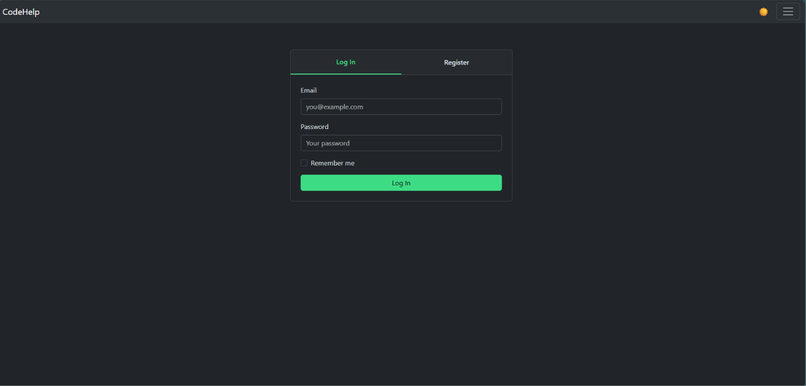
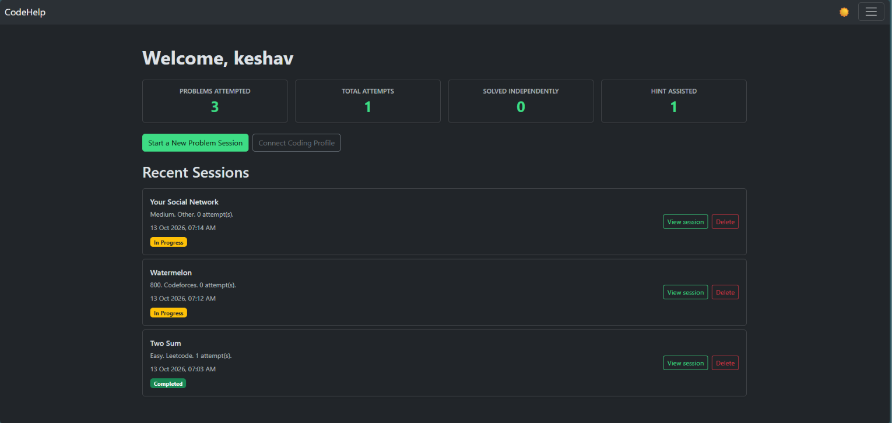
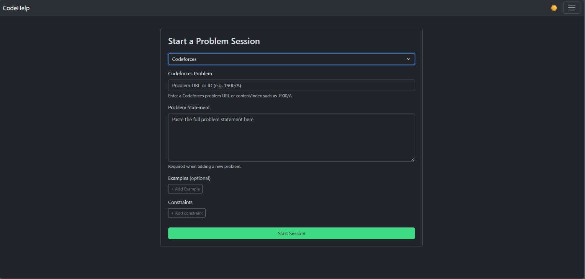
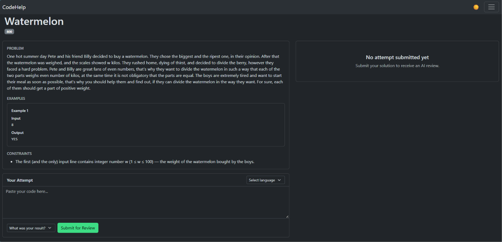
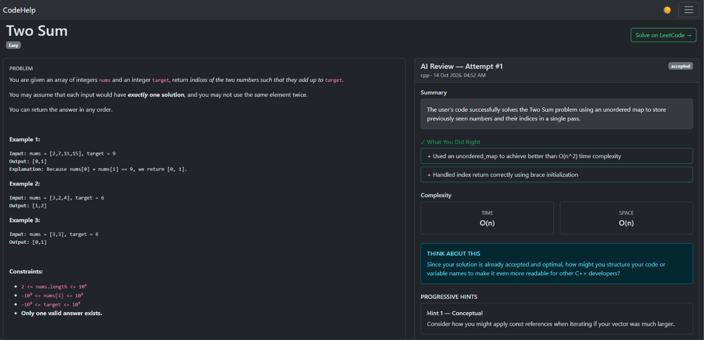
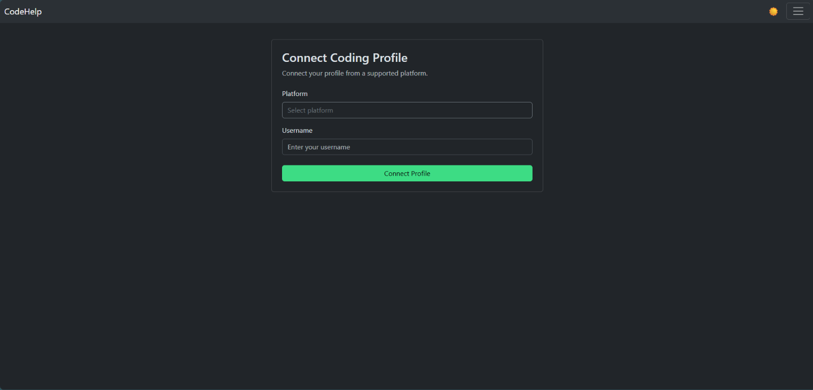

# CodeHelp — AI-Powered Coding Practice & Review

**Practise coding. Understand your mistakes. Improve with AI-assisted feedback.**

CodeHelp is an AI-powered coding practice platform that helps users work through programming problems, submit multiple attempts, receive AI-generated code reviews, and learn through hints and structured feedback.

It integrates with LeetCode and Codeforces problem workflows and uses Google Gemini to generate reviews and solution explanations.

**Live Demo:** [Open CodeHelp](https://codehelp-gqa6.onrender.com)

---

## Features

### AI-Powered Code Review
- Submit coding solutions for AI-assisted evaluation.
- Receive structured feedback on submitted attempts.
- Retry AI review generation when an external AI request fails, without submitting a duplicate attempt.

### Coding Sessions and Attempt History
- Create a dedicated session for a coding problem.
- Submit and track multiple attempts within the same session.
- Review the latest attempt and access previous submissions.
- Delete individual attempts or entire sessions.
- Browse coding sessions through a paginated session-history page.

### Problem Integrations
- **LeetCode:** Look up problems using supported problem identifiers or slugs.
- **Codeforces:** Retrieve problem metadata through the official Codeforces API.
- **Manual problems:** Add custom problems with statements, examples, constraints, and difficulty information.

For newly encountered Codeforces problems, users may need to provide the problem statement manually.

### Hints and Reference Solutions
- Unlock hints while working through a problem.
- Reveal a reference solution only after meeting the application's eligibility requirements.
- Store reference solutions by programming language, with a language-independent explanation.

The solution-reveal rule requires all three conditions:
- At least two attempts submitted.
- At least one hint unlocked.
- At least ten minutes elapsed since the session started.

### Accounts and Coding Profiles
- User registration and login.
- Persistent login through the Remember Me option.
- Connect and disconnect coding profiles.
- Retrieve supported Codeforces profile statistics.

### Dashboard and Session Management
- View coding-session statistics.
- Access recent coding sessions.
- Browse the complete session history with pagination.
- Manage attempts and sessions through authenticated actions.

---

## Tech Stack

| Layer | Technologies |
|---|---|
| Backend | Python, Flask |
| Database and ORM | PostgreSQL, SQLite, Flask-SQLAlchemy, SQLAlchemy |
| Authentication | Flask-Login, Flask-Bcrypt |
| Security | Flask-WTF, CSRF protection, environment-based configuration |
| AI integration | Google Gemini API, `google-genai` |
| Frontend | HTML, CSS, JavaScript, Jinja2 |
| External integrations | LeetCode GraphQL, official Codeforces API |
| Production server | Gunicorn |
| Deployment | Render |
| Database hosting | Aiven PostgreSQL |

---

## Architecture Overview

CodeHelp uses Flask's application-factory pattern and separates application responsibilities into routes, database models, AI services, and platform integrations.

At a high level, the application follows this flow:

1. A user authenticates and starts a coding session.
2. The application retrieves an existing problem or obtains supported problem metadata from an external service.
3. The user submits a solution as an attempt.
4. The backend stores the attempt and requests an AI review.
5. The review is stored and presented to the user.
6. If review generation fails, the attempt remains available for a retry.
7. Session history and dashboard information are retrieved from the database.

### Main Components

- **Application factory:** Initializes Flask, extensions, configuration, and routes.
- **Routes:** Handle authentication, coding sessions, attempts, profile operations, and session history.
- **Database models:** Represent users, problems, sessions, attempts, reviews, and coding profiles.
- **AI services:** Generate code reviews and reference-solution explanations.
- **Platform services:** Integrate with LeetCode and Codeforces.
- **Templates and JavaScript:** Provide the user interface and dynamic form interactions.

---

## Screenshots

### 1. Login


### 2. Dashboard


### 3. Start Session


### 4. Coding Session


### 5. AI-Generated Review


### 6. Coding Profile Integration


---

## Local Setup

### Prerequisites

- Python installed.
- Git installed.
- A Google Gemini API key.
- PostgreSQL for a PostgreSQL-backed local setup, or SQLite for basic local development.

### 1. Clone the repository

```bash
git clone https://github.com/Rohitk-18/CodeHelp.git
cd CodeHelp
```

### 2. Create a virtual environment

**Windows PowerShell**

```powershell
python -m venv venv
.\venv\Scripts\Activate.ps1
```

**macOS/Linux**

```bash
python3 -m venv venv
source venv/bin/activate
```

### 3. Install dependencies

```bash
pip install -r requirements.txt
```

### 4. Configure environment variables

Create a `.env` file in the project root:

```env
SECRET_KEY=your_random_secret_key
GEMINI_API_KEY=your_gemini_api_key
FLASK_ENV=development
```

For local SQLite development, the application defaults to:

```text
sqlite:///codehelp.db
```

If you want to use PostgreSQL locally, configure `DATABASE_URL` with your PostgreSQL connection URI and the appropriate connection settings.

### 5. Run the application

```bash
python run.py
```

Open the local URL shown in the terminal, typically:

http://127.0.0.1:5000

---

## Environment Variables

| Variable | Purpose |
|---|---|
| `SECRET_KEY` | Flask session signing and application security |
| `GEMINI_API_KEY` | Authenticates requests to the Google Gemini API |
| `DATABASE_URL` | Optional database connection URI; SQLite is used by default when unset |
| `FLASK_ENV` | Controls the application's production-related configuration |

For production, configure these variables through the hosting provider's environment settings. Use a PostgreSQL URI with the correct SQLAlchemy scheme and preserve any required SSL parameters.

---

## Known Limitations

- New Codeforces problems may require manual entry of the problem statement because the current integration focuses on official API metadata.
- AI-generated reviews depend on the availability and configuration of the external Gemini API.

---

## Future Improvements

Potential future work includes:

- Improved API rate limiting and external-service error handling.
- More detailed progress analytics and coding-session insights.
- Additional problem-platform integrations.
- Improved accessibility and mobile responsiveness.
